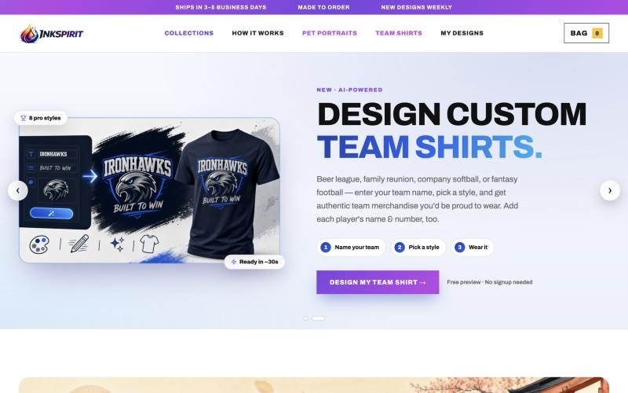
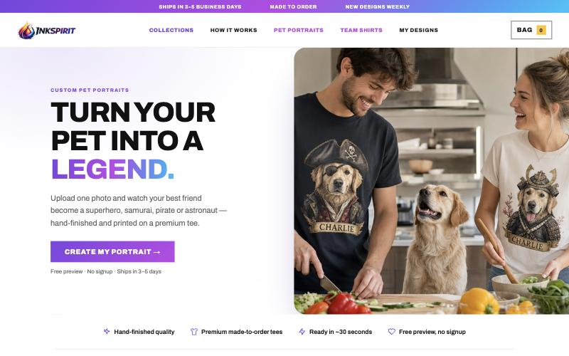
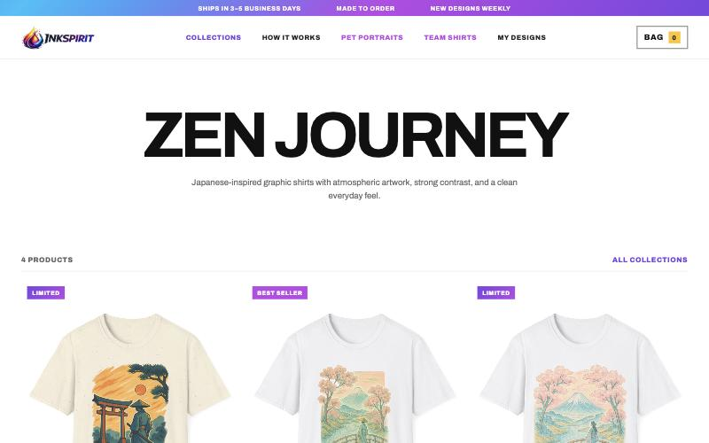
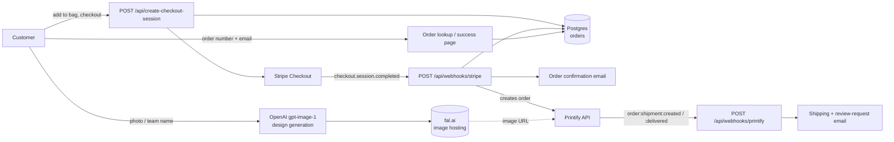

<p align="center">
  
</p>

<p align="center">
  <strong>AI-powered graphic t-shirt storefront — generate a design, check out, and it ships from an on-demand print shop.</strong>
</p>

<p align="center">
  <a href="https://inkspirit.shop">Live store</a> ·
  <a href="#features">Features</a> ·
  <a href="#architecture">Architecture</a> ·
  <a href="#getting-started">Getting started</a>
</p>

<p align="center">
  
  
  
  
  
  
  
  
</p>

---

<p align="center">
  
</p>

## The idea

Most print-on-demand storefronts sell designs someone else already made. InkSpirit lets the customer make the design: upload a photo of their dog and get it turned into a superhero portrait, or type a team name and get a full kit with roster names and numbers. The AI render becomes a real, shippable product in the same flow, no account or signup required to preview it.

## Features

- **AI design generation** — pet portraits and team shirts rendered on the fly with OpenAI's `gpt-image-1`, hosted via fal.ai for Printify to fetch
- **Curated collections** alongside the generated designs, with per-size/per-color Printify variants
- **Stripe Checkout** for payment, with promo code support
- **Automatic fulfillment** — a paid order becomes a real Printify order via webhook, no manual step
- **Order lookup** by order number + email, with live status pulled from Stripe/Printify
- **Verified-buyer reviews**, gated to real order numbers
- **Transactional email** (confirmation, shipping, review request) via Resend
- **SEO landing pages** with prerendering and sitemap generation for organic discovery

<table>
<tr>
<td width="50%">

</td>
<td width="50%">

</td>
</tr>
</table>

## Architecture



**Stack:** Vue 3 + Vue Router on Vite · Express 5 (ESM, serves the built frontend in production) · Postgres for orders and reviews · Stripe Checkout for payment · Printify for print-on-demand fulfillment · OpenAI + fal.ai for AI design generation · Resend for transactional email.

A few things worth noting in the code:

- **Fulfillment only fires from a verified webhook.** `checkout.session.completed` is the single source of truth for "this order was paid" — the success page just reads state back, it never triggers fulfillment itself.
- **Every email send is idempotent.** Confirmation, shipping and review-request emails each have their own `*SentAt` guard on the order row, so retried webhooks (Stripe and Printify both retry on failure) can't double-send.
- **Products without a `printify` block simply can't be bought.** The cart checks for it and blocks checkout with a warning, so an unfinished catalog entry can't reach Stripe.
- **No component-scoped CSS.** One `src/styles.css` for the whole app — a deliberate trade of encapsulation for a single place to see and change the design system.

## Getting Started

```bash
npm install
cp .env.example .env.local   # fill in API keys — see below
npm run dev
```

This runs Vite (`:5173`) and the Express API (`:4242`) together; Vite proxies `/api/*` to Express. Open **http://localhost:5173**.

## Commands

```bash
npm run dev      # Vite + Express, with hot reload
npm run build    # production build → dist/
npm start        # build + serve via Express (production mode)
npm test         # Vitest suite (unit + API + component)
```

## Environment Variables

Copy `.env.example` to `.env.local` and fill in:

| Variable | Description |
|---|---|
| `STRIPE_SECRET_KEY` | Stripe secret key (`sk_test_...` / `sk_live_...`) |
| `STRIPE_WEBHOOK_SECRET` | From `stripe listen` (dev) or the Stripe Dashboard (prod) |
| `PRINTIFY_API_TOKEN` | Printify personal access token |
| `PRINTIFY_SHOP_ID` | Printify shop ID |
| `PRINTIFY_WEBHOOK_SECRET` | Optional — verifies incoming Printify shipment webhooks |
| `DATABASE_URL` | Postgres connection string (order + review storage) |
| `OPENAI_API_KEY` | Powers AI pet portrait / team shirt generation |
| `FAL_KEY` | Hosts generated images so Printify can fetch them |
| `RESEND_API_KEY` | Transactional email (no-ops until set) |
| `EMAIL_FROM` | From address for transactional email |
| `SITE_URL` | Full site URL (Stripe redirects, image URLs) |
| `PORT` | Defaults to `4242` |

Optional analytics (build-time): `VITE_GA_MEASUREMENT_ID`, `VITE_PLAUSIBLE_DOMAIN`, `VITE_GOOGLE_ADS_ID`, `VITE_GOOGLE_ADS_PURCHASE_LABEL`.

## Project Structure

```
server/
  index.js          # Express server — API routes + static serving
  emails.js          # Transactional email templates (order confirmation, shipping, review)
src/
  data/products.js  # Product and collection catalog
  composables/       # useCart, etc.
  pages/            # Routed Vue page components
  components/       # SiteHeader, CartDrawer, ShirtCard, CollectionCard, Icon
  styles.css        # All styles (no component-scoped CSS)
scripts/            # Prerendering, Printify webhook registration
tests/              # Vitest suite
```

## Testing

```bash
npm test
```

Covers checkout validation, order lifecycle, fulfillment status, email builders (including XSS escaping), cart/design composables, and component rendering. The Postgres-backed integration tests run only with `TEST_DB=1` and `DATABASE_URL` set — CI provides this automatically (see [`.github/workflows/test.yml`](.github/workflows/test.yml)).

## Deployment

Deployed on Railway: push to GitHub, connect the repo, set the environment variables above, and Railway runs `npm start`. See [`CLAUDE.md`](CLAUDE.md) for the full production setup and go-live checklist (Stripe webhooks, Printify webhook registration, email domain verification).

## About

Built by **Justin Wagner**.

📫 [justintwagner1@gmail.com](mailto:justintwagner1@gmail.com) · 🌐 [inkspirit.shop](https://inkspirit.shop)
